# 🌶️ Come installare 'Nduja Dashboard

🇬🇧 *English version: [HOW_TO_INSTALL.md](HOW_TO_INSTALL.md)*

Questa guida è per chi non è esperto: bastano una decina di minuti, un computer o un tablet e un utente **amministratore** di Home Assistant.
Non si scrive niente a mano: niente YAML, niente file da copiare.

**Ti serve:** Home Assistant 2024.12 o successivo. Per sapere quale hai: Impostazioni → Informazioni.

> ℹ️ Le immagini dei passi 1–5 sono **disegni semplificati** delle schermate di Home Assistant: servono a mostrare dove toccare, la tua schermata può essere un po' diversa. Le altre sono la plancia vera, con una casa inventata.

**Indice**
1. [Aggiungi 'Nduja al Marketplace](#1-aggiungi-nduja-al-marketplace)
2. [Scarica 'Nduja](#2-scarica-nduja)
3. [Riavvia Home Assistant](#3-riavvia-home-assistant)
4. [Aggiungi l'integrazione](#4-aggiungi-lintegrazione)
5. [Apri 🌶️ 'Nduja](#5-apri--nduja)
6. [La procedura guidata: Automatica o Manuale](#6-la-procedura-guidata-automatica-o-manuale)
- [Prepara la casa](#prepara-la-casa)
- [Problemi frequenti](#problemi-frequenti)

---

## 1. Aggiungi 'Nduja al Marketplace

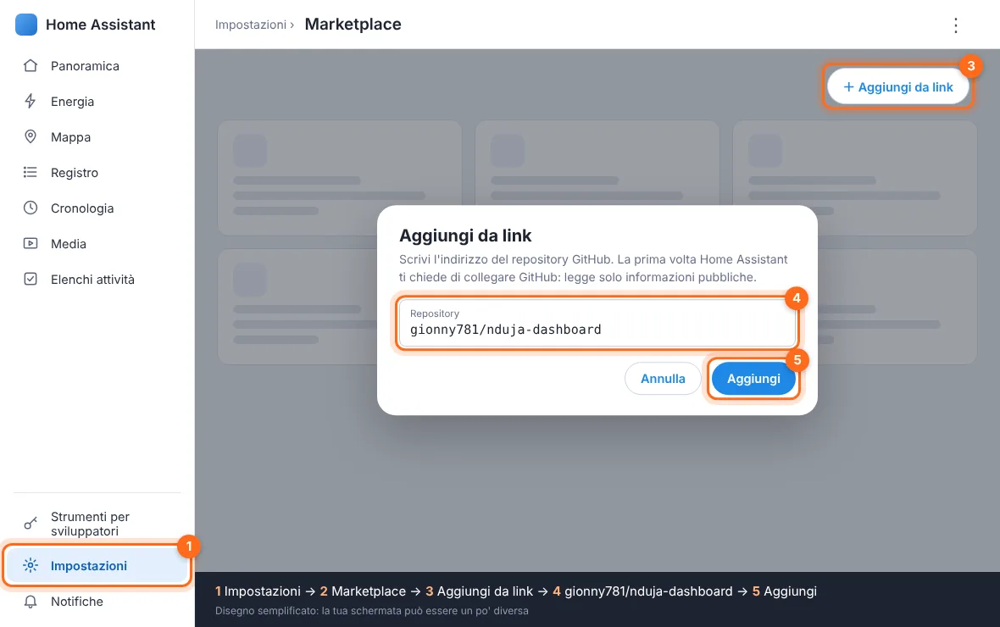

Con **Home Assistant 2026.11 o successivo**:
1. apri **Impostazioni** (in basso nella barra laterale);
2. tocca **Marketplace**;
3. in alto a destra tocca **Aggiungi da link**;
4. scrivi `gionny781/nduja-dashboard`;
5. tocca **Aggiungi**.

La prima volta Home Assistant ti chiede di **collegare GitHub**, dove si trova 'Nduja: segui i passi che ti mostra. Legge solo informazioni pubbliche.

> **Hai Home Assistant 2026.10 o precedente?** Il Marketplace non c'è ancora: si usa **HACS**, che deve essere già installato ([istruzioni di HACS](https://hacs.xyz/docs/use/)).
>
> 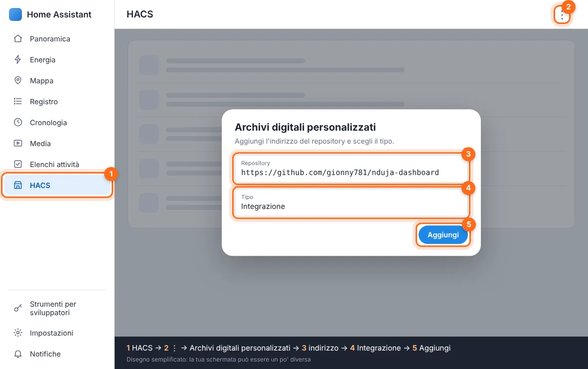
>
> 1. apri **HACS** nella barra laterale;
> 2. in alto a destra tocca **⋮** → **Archivi digitali personalizzati**;
> 3. scrivi `https://github.com/gionny781/nduja-dashboard`;
> 4. come tipo scegli **Integrazione**;
> 5. tocca **Aggiungi**, chiudi la finestra e cerca **'Nduja Dashboard** in HACS.
>
> Quando aggiornerai Home Assistant alla 2026.11, 'Nduja passerà da sola al Marketplace.

## 2. Scarica 'Nduja

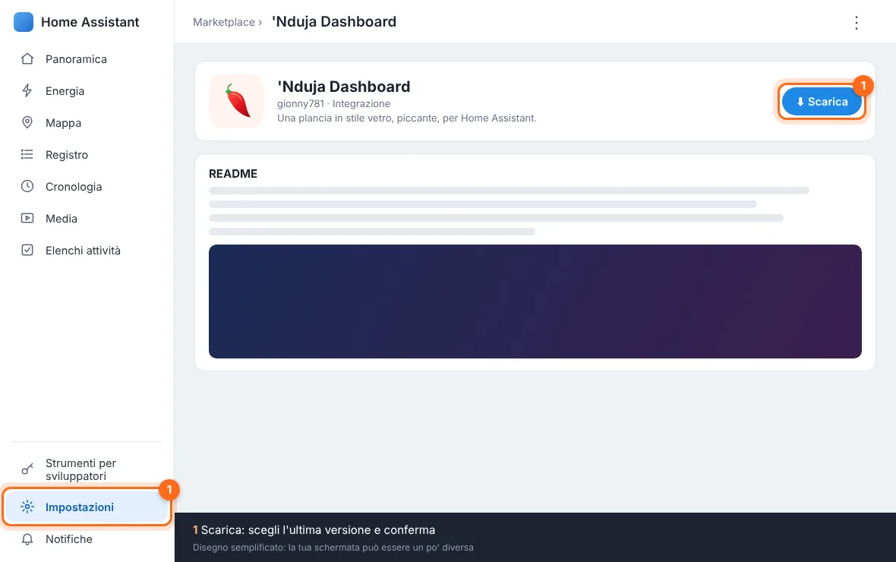

Apri **'Nduja Dashboard** e tocca **Scarica** (in HACS: **Scarica** in basso a destra). Lascia l'ultima versione proposta e conferma.

**Vuoi provare le anteprime?** Le versioni che finiscono con `-dev` sono anteprime delle novità: possono avere qualche difetto.
Nel Marketplace si ricevono con l'interruttore **Pre-release** della pagina del dispositivo, **prima** di scaricare:

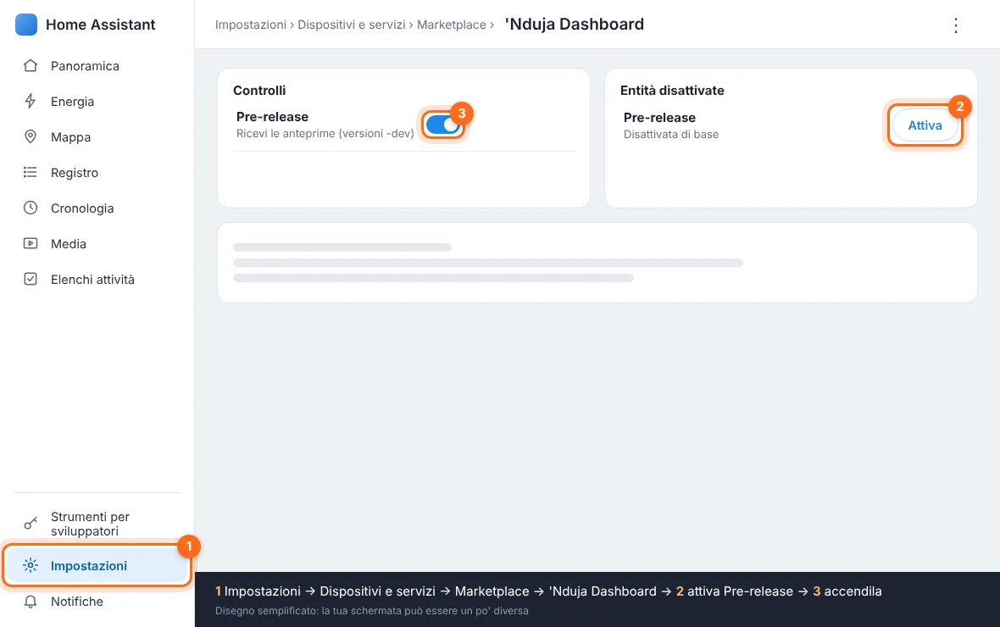

1. Impostazioni → Dispositivi e servizi → **Marketplace** → **'Nduja Dashboard**;
2. l'entità **Pre-release** è disattivata di base: tocca **Attiva**;
3. poi **accendila**. Da adesso il Marketplace ti propone anche le anteprime.

In HACS (fino alla 2026.10): 'Nduja Dashboard → **⋮** → **Riscarica** → accendi **«Mostra versioni beta»** → scegli la versione.

## 3. Riavvia Home Assistant

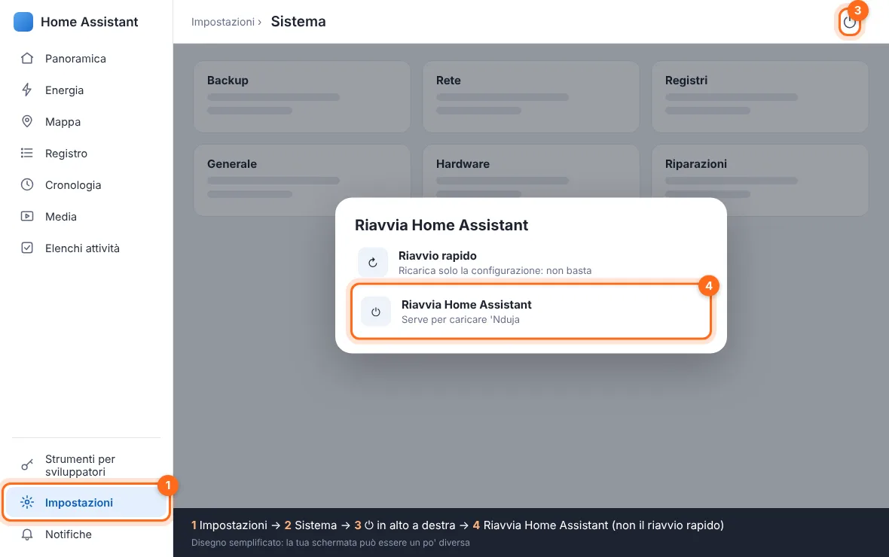

Home Assistant carica le integrazioni nuove solo quando si riavvia:
**Impostazioni → Sistema → ⏻** (in alto a destra) → **Riavvia Home Assistant**.
Il «Riavvio rapido» non basta. Aspetta un minuto e ricarica la pagina.

## 4. Aggiungi l'integrazione

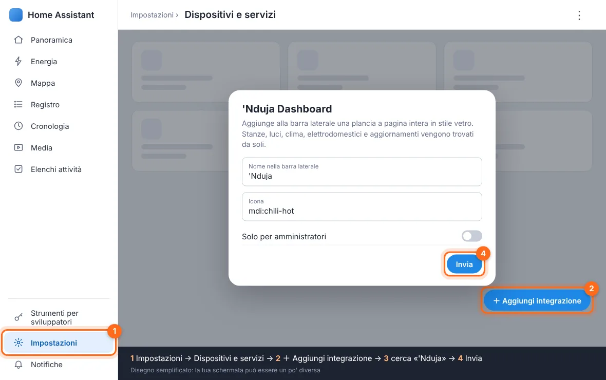

1. **Impostazioni → Dispositivi e servizi**;
2. in basso a destra **＋ Aggiungi integrazione**;
3. cerca **'Nduja** e toccala;
4. tocca **Invia**.

Puoi lasciare tutto com'è: il nome e l'icona nella barra laterale e «Solo per amministratori» si cambiano quando vuoi da
Impostazioni → Dispositivi e servizi → 'Nduja Dashboard → **Configura**, dove ci sono anche i sensori dell'energia (facoltativi: se li lasci vuoti la plancia li cerca da sola).

> Se compare «'Nduja Dashboard è già installata», l'integrazione c'è già: vai al passo 5.

## 5. Apri 🌶️ 'Nduja

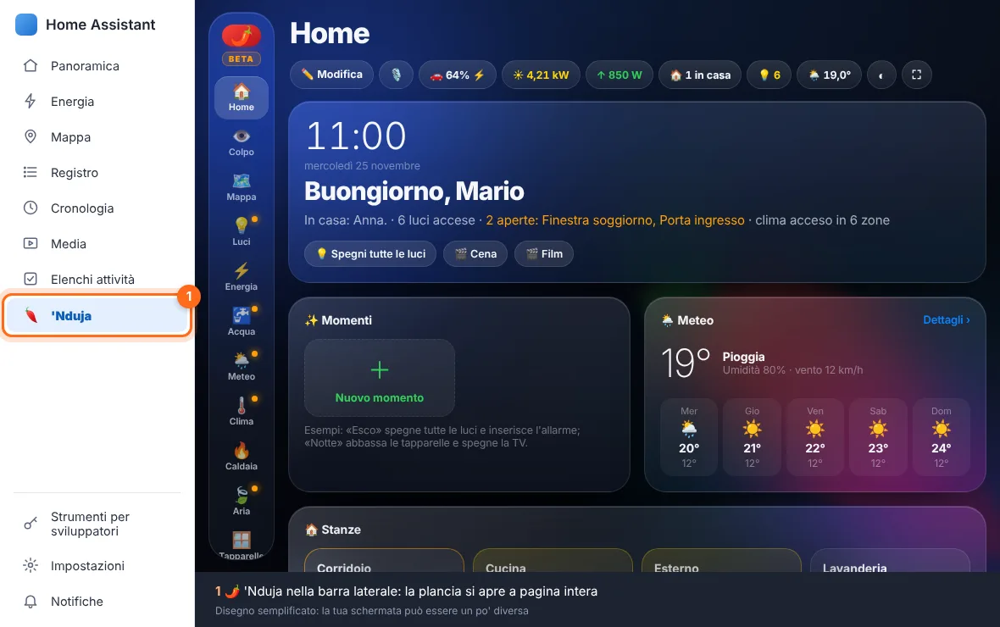

Nella barra laterale è comparso **🌶️ 'Nduja**: toccalo e la plancia si apre a pagina intera.
Funziona anche nell'app Home Assistant del telefono e del tablet (sul telefono la barra laterale si apre con ☰).

## 6. La procedura guidata: Automatica o Manuale

La prima volta un amministratore vede il benvenuto, con due scelte:

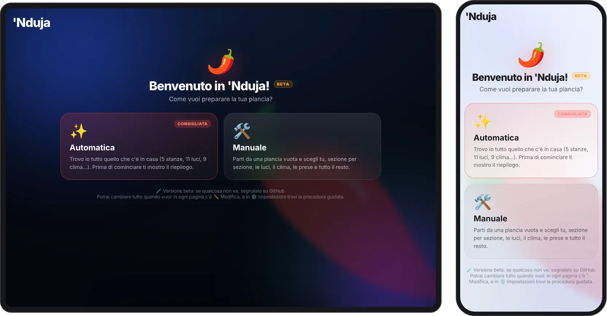

- **✨ Automatica** (consigliata): la plancia trova da sola stanze, luci, clima, dispositivi, persone e telecamere.
  Prima di cominciare ti mostra il **riepilogo** di quello che ha trovato e delle pagine che compariranno:

  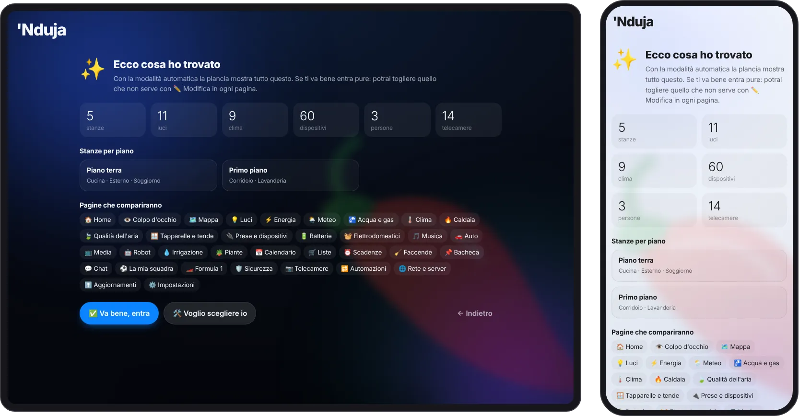

  Tocca **✅ Va bene, entra**, oppure **🛠️ Voglio scegliere io** per passare alla procedura guidata.
- **🛠️ Manuale**: parti da una plancia vuota e scegli tu, un passo alla volta.

La **procedura guidata** ha otto passi: Inizio, Stanze, Luci, Clima, Dispositivi, Casa, Pagine e Fine.

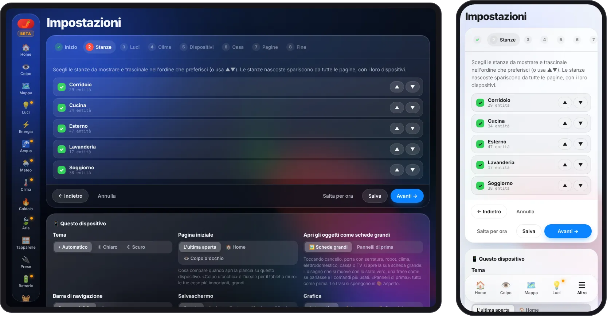

- **Avanti** e **Indietro** per muoverti, **Salta per ora** se un passo non ti interessa, **Salva** quando vuoi.
- Se chiudi a metà, la volta dopo la plancia ti propone di **riprendere da dove eri**.
- Le scelte si salvano in Home Assistant e valgono su tutti i dispositivi: le persone di casa non devono rifare niente.

**Dopo** puoi cambiare tutto quando vuoi, senza ripartire da zero:
- **✏️ Modifica** in ogni pagina: ＋ Aggiungi, rinomina, sposta in un'altra stanza, ✕ togli, trascina per riordinare;
- **⚙️ Impostazioni**: la procedura guidata, l'aspetto, il salvaschermo, **✨ Cosa puoi aggiungere** e **🩺 Controlla Home Assistant**.

Le pagine compaiono da sole quando in casa c'è qualcosa che le usa (per esempio la pagina Auto solo se Home Assistant ha un'auto).

📖 **Per usare la plancia giorno per giorno** c'è il [manuale di istruzioni in PDF](custom_components/nduja_dashboard/frontend/manuale/Nduja-manuale-it.pdf): ogni pagina spiegata in parole semplici. Lo trovi anche nella plancia, in cima a **⚙️ Impostazioni** («Apri» o «Scarica PDF»).

---

## Prepara la casa

La plancia si costruisce da quello che Home Assistant sa della tua casa. Più è in ordine, più la plancia è bella e completa.
Non è obbligatorio farlo prima: puoi sistemare tutto anche dopo, e la plancia si aggiorna da sola.

**🩺 Controlla Home Assistant** (⚙️ Impostazioni, solo amministratori) controlla tutto questo per te, in parole semplici: per ogni ⚠️ il pulsante **Apri** porta alla schermata giusta di Home Assistant. Legge soltanto, non cambia niente.

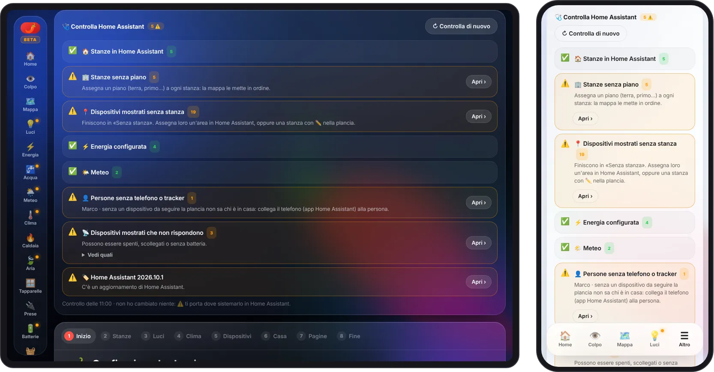

### 🏠 Aree (le stanze)
**Perché:** la Home mostra la casa stanza per stanza (temperatura, luci accese, finestre aperte); la mappa e la casa in 3D disegnano una stanza per ogni area.
**Dove:** Impostazioni → **Aree, etichette e zone** → ＋ Crea area (Cucina, Soggiorno, Camera…).
Poi assegna ogni dispositivo alla sua stanza: Impostazioni → Dispositivi e servizi → **Dispositivi** → apri il dispositivo → ✏️ → Area.
I dispositivi senza area finiscono in «Senza stanza»; puoi anche assegnare la stanza dalla plancia, con ✏️.

### 🏢 Piani
**Perché:** le stanze si dividono per piano nella Home, nelle Luci, nel Clima e nella mappa; in 3D i piani si impilano uno sull'altro.
**Dove:** Impostazioni → **Aree, etichette e zone** → ＋ Crea piano (Piano terra, Primo piano…), poi apri ogni area e scegli il suo piano.
Con un solo piano puoi saltare questo passo.

### 👤 Persone con il telefono
**Perché:** la plancia sa chi è in casa, quanto è lontano chi è fuori e quanta batteria ha il telefono; le notifiche (scadenze, piante, chat, Formula 1…) arrivano sul telefono giusto.
**Dove:**
1. installa sul telefono l'**app ufficiale Home Assistant** (App Store o Google Play) e accedi alla tua casa;
2. Impostazioni → **Persone** → apri la persona (o ＋ Aggiungi persona);
3. tra i **dispositivi da tracciare** scegli il telefono;
4. per la chat di famiglia scegli anche l'**utente** con cui la persona entra in Home Assistant.

### ⚡ Configurazione Energia
**Perché:** le pagine Energia e Acqua e gas, i costi, il salvaschermo del fotovoltaico e i consumi del gas della caldaia leggono da qui.
**Dove:** Impostazioni → **Plance** → **Energia** (oppure la pagina Energia di Home Assistant): aggiungi il **consumo dalla rete** e, se li hai, **fotovoltaico**, **batteria**, **acqua** e **gas**, con i prezzi.
Senza la configurazione Energia la plancia prova a trovare da sola i sensori di potenza; per sceglierli a mano: Impostazioni → Dispositivi e servizi → 'Nduja Dashboard → Configura.

---

## Problemi frequenti

### La plancia è bianca o dice «La plancia non riesce a partire»

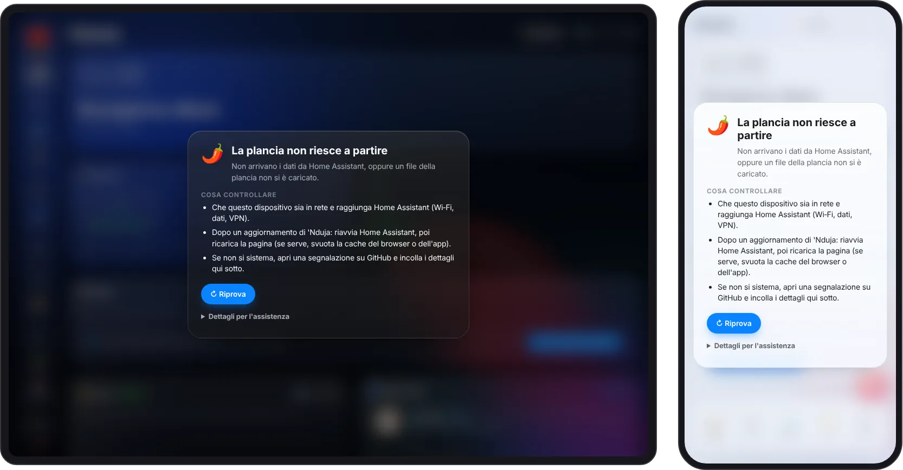

Al posto della pagina bianca la plancia mostra cosa controllare:
1. che il dispositivo sia in rete e raggiunga Home Assistant (Wi-Fi, dati, VPN);
2. **dopo un aggiornamento** di 'Nduja: riavvia Home Assistant (passo 3), poi ricarica la pagina; se serve, svuota la cache del browser o dell'app Home Assistant;
3. tocca **Riprova**.

Quando la plancia riparte, usa **⚙️ Impostazioni → 🩺 Controlla Home Assistant**. Se non si sistema, apri una [segnalazione su GitHub](https://github.com/gionny781/nduja-dashboard/issues) e incolla i **Dettagli per l'assistenza** che trovi sotto «Riprova».

### Alcuni dispositivi non compaiono
- **Hai scelto Manuale?** Si vede solo quello che aggiungi: in ogni pagina **✏️ Modifica → ＋ Aggiungi** (in cima trovi i **Suggeriti**).
- **Sono nascosti o di servizio?** La plancia ignora le entità nascoste in Home Assistant e quelle di configurazione o diagnostica. Puoi aggiungerle a mano con ＋ Aggiungi.
- **Non hanno una stanza?** Finiscono in «Senza stanza»: assegna l'area (vedi [Prepara la casa](#-aree-le-stanze)).
- **Manca una pagina intera?** Le pagine compaiono solo quando c'è qualcosa che le usa. **⚙️ Impostazioni → ✨ Cosa puoi aggiungere** ti dice cosa serve e, se il dispositivo c'è ma non l'ho riconosciuto, ti fa sceglierlo.
- **L'hai appena aggiunto in Home Assistant?** In Home compare «N dispositivi nuovi trovati»: aggiungilo con un tocco.

### Le telecamere mostrano la foto ma non la diretta
- La diretta più veloce (WebRTC) passa da **go2rtc**, che Home Assistant include dalla versione 2024.11. Se la diretta non parte, controlla che la telecamera funzioni in Home Assistant (apri la sua scheda) e che go2rtc non sia stato tolto o fermato.
- Se WebRTC non va, la plancia prova da sola HLS, poi MJPEG, poi una foto ogni 2 secondi, e ricorda il metodo che funziona su quel dispositivo.
- In **Telecamere → ✏️** puoi scegliere il flusso principale per la diretta, il sub-stream per l'anteprima e il metodo di ogni flusso.
- Fuori casa la diretta WebRTC può non passare dalla rete del telefono: in quel caso la plancia usa gli altri metodi.

### Le notifiche sul telefono non arrivano
- Le notifiche passano dall'**app ufficiale Home Assistant**: deve essere installata, con l'accesso fatto e le notifiche **permesse** nelle impostazioni del telefono.
- Il telefono deve comparire in Impostazioni → Dispositivi e servizi → **Mobile App**, e deve essere collegato alla persona (Impostazioni → Persone, tra i dispositivi da tracciare).
- Le notifiche della plancia si accendono nella pagina di ogni funzione (Scadenze, Piante, Formula 1, La mia squadra, Chat…): controlla che siano accese e che sia scelto il telefono giusto.
- Prova a mandarti una notifica di prova: Strumenti per sviluppatori → Azioni → `notify.mobile_app_…`. Se non arriva neanche quella, il problema è nell'app o nel telefono.

### Anteprime e versioni beta
- Le versioni `-dev` sono **anteprime**: escono prima della versione ufficiale e possono avere difetti. Senza fare niente ricevi solo le versioni ufficiali.
- **Marketplace** (2026.11 e successive): Impostazioni → Dispositivi e servizi → Marketplace → 'Nduja Dashboard → attiva e accendi **Pre-release** (vedi il [passo 2](#2-scarica-nduja)). Per tornare alle versioni ufficiali spegnilo e scarica l'ultima versione senza `-dev`.
- **HACS** (fino alla 2026.10): 'Nduja Dashboard → ⋮ → **Riscarica** → «Mostra versioni beta» → scegli la versione.
- Dopo ogni aggiornamento **riavvia Home Assistant**.
- Hai trovato un difetto? Scrivilo nelle [Issues](https://github.com/gionny781/nduja-dashboard/issues): è il modo migliore per aiutare.
