# 🌶️ How to install 'Nduja Dashboard

🇮🇹 *Versione italiana: [COME_INSTALLARE.md](COME_INSTALLARE.md)*

This guide is for non-experts: it takes about ten minutes, a computer or tablet and a Home Assistant **administrator** user.
You don't write anything by hand: no YAML, no files to copy.

**You need:** Home Assistant 2024.12 or newer. To check yours: Settings → About.

> ℹ️ The pictures of steps 1–5 are **simplified drawings** of the Home Assistant screens: they show where to tap, your screen may look a little different. The others are the real dashboard, with a made-up home.

**Contents**
1. [Add 'Nduja to the Marketplace](#1-add-nduja-to-the-marketplace)
2. [Download 'Nduja](#2-download-nduja)
3. [Restart Home Assistant](#3-restart-home-assistant)
4. [Add the integration](#4-add-the-integration)
5. [Open 🌶️ 'Nduja](#5-open--nduja)
6. [The setup wizard: Automatic or Manual](#6-the-setup-wizard-automatic-or-manual)
- [Get your home ready](#get-your-home-ready)
- [Common problems](#common-problems)

---

## 1. Add 'Nduja to the Marketplace

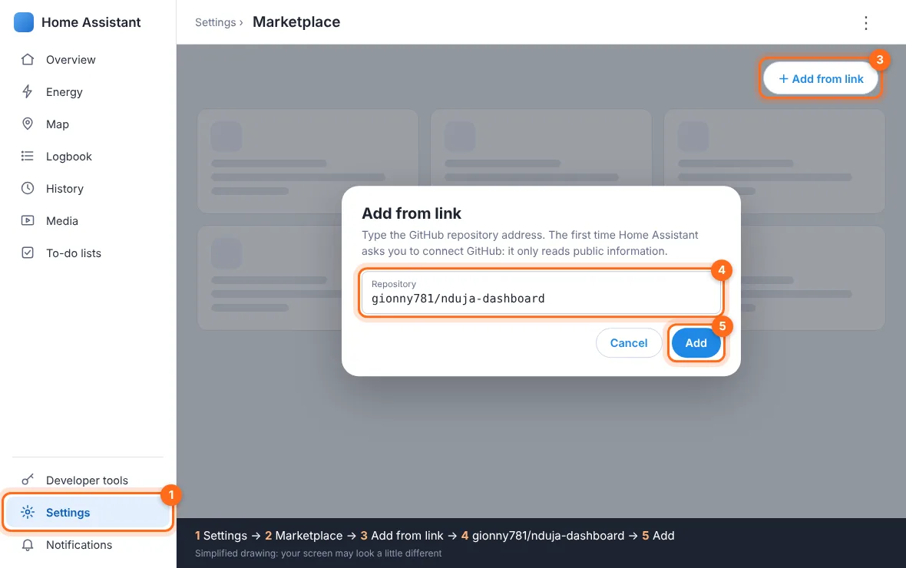

With **Home Assistant 2026.11 or newer**:
1. open **Settings** (at the bottom of the sidebar);
2. tap **Marketplace**;
3. at the top right tap **Add from link**;
4. type `gionny781/nduja-dashboard`;
5. tap **Add**.

The first time Home Assistant asks you to **connect GitHub**, where 'Nduja lives: follow the steps it shows. It only reads public information.

> **Running Home Assistant 2026.10 or older?** There's no Marketplace yet: you use **HACS**, which must already be installed ([HACS instructions](https://hacs.xyz/docs/use/)).
>
> 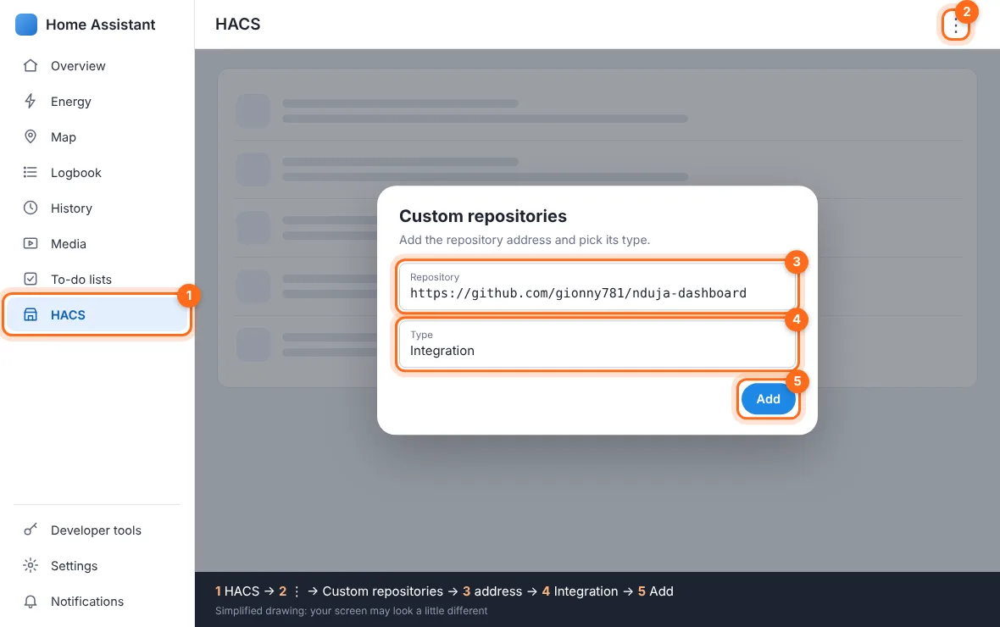
>
> 1. open **HACS** in the sidebar;
> 2. at the top right tap **⋮** → **Custom repositories**;
> 3. type `https://github.com/gionny781/nduja-dashboard`;
> 4. pick **Integration** as the type;
> 5. tap **Add**, close the window and search for **'Nduja Dashboard** in HACS.
>
> When you upgrade Home Assistant to 2026.11, 'Nduja moves to the Marketplace by itself.

## 2. Download 'Nduja

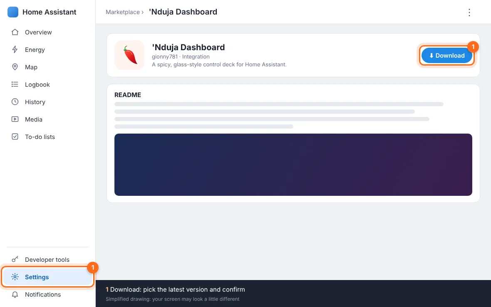

Open **'Nduja Dashboard** and tap **Download** (in HACS: **Download** at the bottom right). Keep the latest version offered and confirm.

**Want to try the previews?** Versions ending in `-dev` are previews of what's coming: they may have a few bugs.
In the Marketplace you get them with the **Pre-release** switch on the device page, **before** downloading:

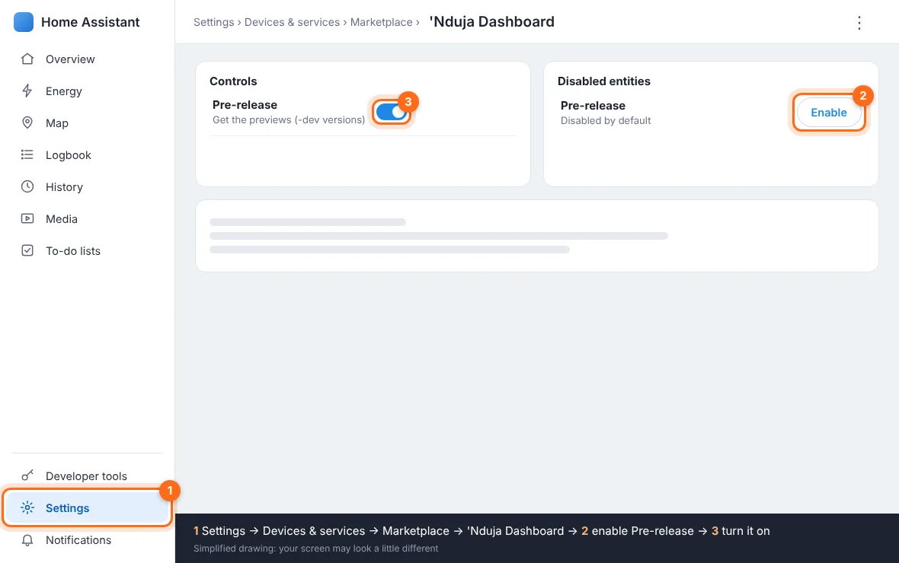

1. Settings → Devices & services → **Marketplace** → **'Nduja Dashboard**;
2. the **Pre-release** entity is disabled by default: tap **Enable**;
3. then **turn it on**. From now on the Marketplace offers the previews too.

In HACS (up to 2026.10): 'Nduja Dashboard → **⋮** → **Redownload** → turn on **«Show beta versions»** → pick the version.

## 3. Restart Home Assistant

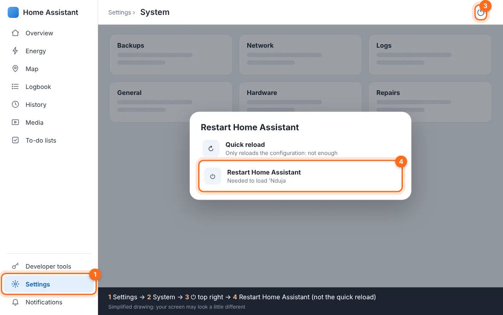

Home Assistant only loads new integrations when it restarts:
**Settings → System → ⏻** (top right) → **Restart Home Assistant**.
«Quick reload» isn't enough. Wait a minute and reload the page.

## 4. Add the integration

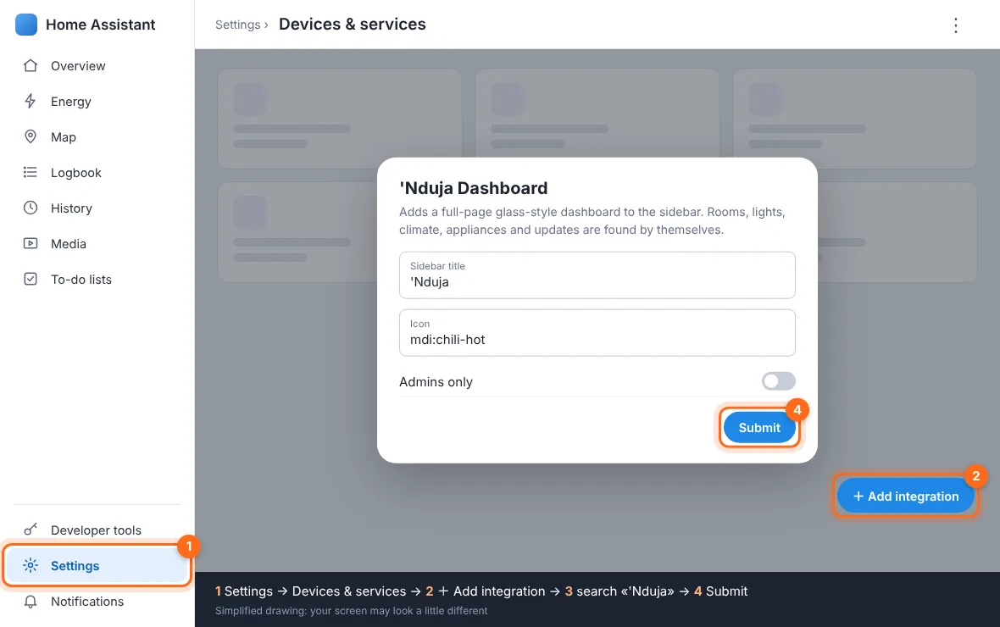

1. **Settings → Devices & services**;
2. at the bottom right **＋ Add integration**;
3. search for **'Nduja** and tap it;
4. tap **Submit**.

You can leave everything as it is: the sidebar name and icon and «Admins only» can be changed any time from
Settings → Devices & services → 'Nduja Dashboard → **Configure**, where you also find the energy sensors (optional: left empty, the dashboard looks for them by itself).

> If it says «'Nduja Dashboard is already installed», the integration is already there: go to step 5.

## 5. Open 🌶️ 'Nduja

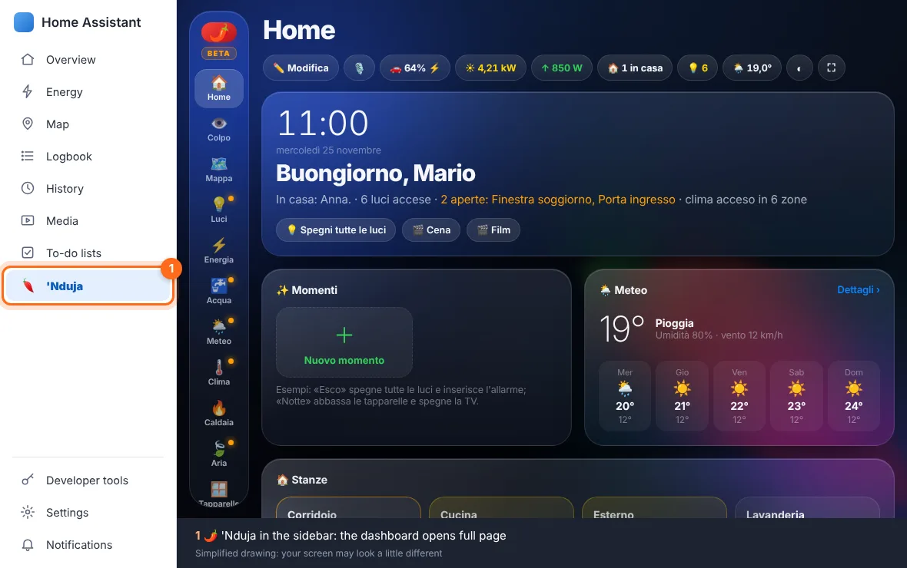

**🌶️ 'Nduja** is now in the sidebar: tap it and the dashboard opens full page.
It works in the Home Assistant app on phones and tablets too (on a phone the sidebar opens with ☰).

## 6. The setup wizard: Automatic or Manual

The first time, an administrator sees the welcome screen with two choices:

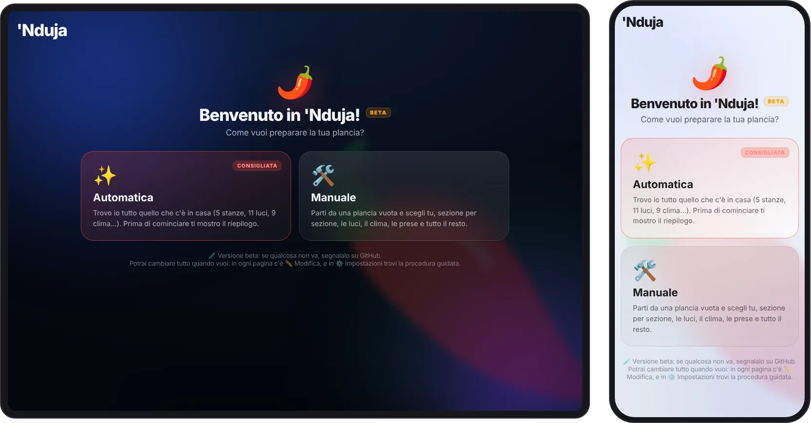

- **✨ Automatic** (recommended): the dashboard finds rooms, lights, climate, devices, people and cameras by itself.
  Before starting it shows a **summary** of what it found and of the pages you'll get:

  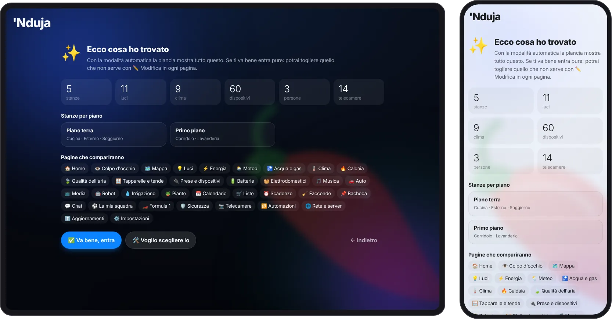

  Tap **✅ Looks good, let's go**, or **🛠️ Let me choose** to go to the setup wizard.
- **🛠️ Manual**: start from an empty dashboard and choose, one step at a time.

The **setup wizard** has eight steps: Start, Rooms, Lights, Climate, Devices, Home, Pages and Done.

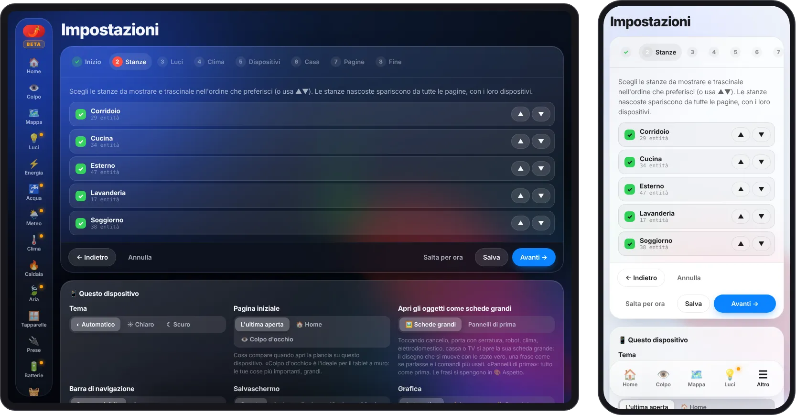

- **Next** and **Back** to move, **Skip for now** if a step doesn't interest you, **Save** whenever you like.
- If you close it halfway, next time the dashboard offers to **pick up where you left off**.
- Choices are saved in Home Assistant and apply to every device: the rest of the family doesn't have to do anything.

**Later** you can change everything, without starting over:
- **✏️ Edit** on every page: ＋ Add, rename, move to another room, ✕ remove, drag to reorder;
- **⚙️ Settings**: the setup wizard, appearance, screensaver, **✨ What you can add** and **🩺 Check Home Assistant**.

Pages show up by themselves when your home has something that uses them (for example the Car page only if Home Assistant has a car).

> The screenshots show the dashboard in Italian; it follows your Home Assistant language, so you'll see it in English.

---

## Get your home ready

The dashboard builds itself from what Home Assistant knows about your home. The tidier it is, the nicer and more complete the dashboard.
You don't have to do it first: you can fix everything later, and the dashboard updates by itself.

**🩺 Check Home Assistant** (⚙️ Settings, admins only) checks all of this for you, in plain words: for each ⚠️ the **Open** button takes you to the right Home Assistant screen. It only reads, it never changes anything.

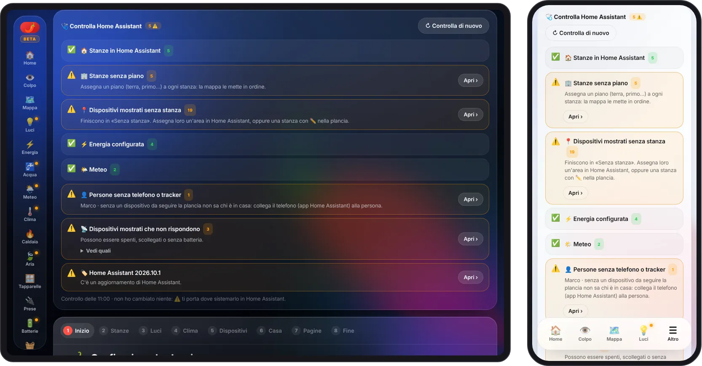

### 🏠 Areas (the rooms)
**Why:** Home shows the house room by room (temperature, lights on, open windows); the map and the 3D house draw one room per area.
**Where:** Settings → **Areas, labels & zones** → ＋ Create area (Kitchen, Living room, Bedroom…).
Then assign each device to its room: Settings → Devices & services → **Devices** → open the device → ✏️ → Area.
Devices without an area end up in «No room»; you can also pick the room from the dashboard, with ✏️.

### 🏢 Floors
**Why:** rooms are grouped by floor on Home, Lights, Climate and the map; in 3D the floors are stacked on top of each other.
**Where:** Settings → **Areas, labels & zones** → ＋ Create floor (Ground floor, First floor…), then open each area and pick its floor.
With a single floor you can skip this.

### 👤 People with their phone
**Why:** the dashboard knows who's home, how far away whoever is out is and how much battery their phone has; notifications (deadlines, plants, chat, Formula 1…) reach the right phone.
**Where:**
1. install the **official Home Assistant app** on the phone (App Store or Google Play) and sign in to your home;
2. Settings → **People** → open the person (or ＋ Add person);
3. among the **devices to track** pick the phone;
4. for the family chat also pick the **user** the person signs in to Home Assistant with.

### ⚡ Energy configuration
**Why:** the Energy and Water and gas pages, the costs, the live solar screensaver and the boiler's gas use read from here.
**Where:** Settings → **Dashboards** → **Energy** (or Home Assistant's Energy page): add **grid consumption** and, if you have them, **solar**, **battery**, **water** and **gas**, with their prices.
Without an Energy configuration the dashboard tries to find the power sensors by itself; to pick them by hand: Settings → Devices & services → 'Nduja Dashboard → Configure.

---

## Common problems

### The dashboard is blank or says «The dashboard can't start»

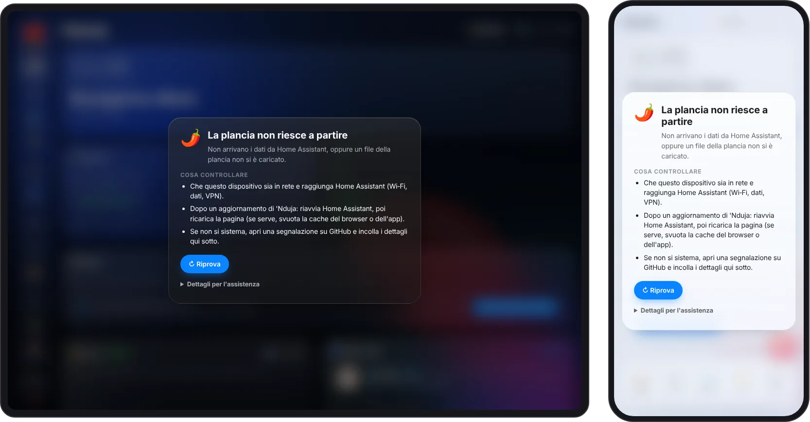

Instead of a blank page the dashboard shows what to check:
1. that the device is online and reaches Home Assistant (Wi-Fi, mobile data, VPN);
2. **after an update** of 'Nduja: restart Home Assistant (step 3), then reload the page; if needed, clear the browser's or the Home Assistant app's cache;
3. tap **Try again**.

When the dashboard starts again, use **⚙️ Settings → 🩺 Check Home Assistant**. If it doesn't get fixed, open an [issue on GitHub](https://github.com/gionny781/nduja-dashboard/issues) and paste the **Details for support** you find under «Try again».

### Some devices don't show up
- **Did you pick Manual?** You only see what you add: on every page **✏️ Edit → ＋ Add** (the **Suggested** ones are at the top).
- **Are they hidden or technical?** The dashboard ignores entities hidden in Home Assistant and configuration or diagnostic ones. You can still add them by hand with ＋ Add.
- **Do they have a room?** They end up in «No room»: assign the area (see [Get your home ready](#-areas-the-rooms)).
- **A whole page is missing?** Pages only show up when something uses them. **⚙️ Settings → ✨ What you can add** tells you what's needed and, if the device is there but wasn't recognised, lets you pick it.
- **Just added it to Home Assistant?** Home shows «N new devices found»: add it with one tap.

### Cameras show the picture but not the live view
- The fastest live view (WebRTC) goes through **go2rtc**, included in Home Assistant since 2024.11. If the live view doesn't start, check that the camera works in Home Assistant (open its card) and that go2rtc hasn't been removed or stopped.
- If WebRTC doesn't work, the dashboard tries HLS, then MJPEG, then a picture every 2 seconds by itself, and remembers the method that works on that device.
- In **Cameras → ✏️** you can pick the main stream for the live view, the sub-stream for the preview and the method of each stream.
- Away from home the WebRTC live view may not get through the phone's network: the dashboard then uses the other methods.

### Phone notifications don't arrive
- Notifications go through the **official Home Assistant app**: it must be installed, signed in, and notifications must be **allowed** in the phone's settings.
- The phone must show up in Settings → Devices & services → **Mobile App**, and be linked to the person (Settings → People, among the devices to track).
- The dashboard's notifications are turned on in each feature's page (Deadlines, Plants, Formula 1, My team, Chat…): check that they're on and that the right phone is picked.
- Send yourself a test notification: Developer tools → Actions → `notify.mobile_app_…`. If that one doesn't arrive either, the problem is in the app or the phone.

### Previews and beta versions
- `-dev` versions are **previews**: they come out before the official version and may have bugs. If you do nothing you only get official versions.
- **Marketplace** (2026.11 and newer): Settings → Devices & services → Marketplace → 'Nduja Dashboard → enable and turn on **Pre-release** (see [step 2](#2-download-nduja)). To go back to official versions turn it off and download the latest version without `-dev`.
- **HACS** (up to 2026.10): 'Nduja Dashboard → ⋮ → **Redownload** → «Show beta versions» → pick the version.
- After every update **restart Home Assistant**.
- Found a bug? Report it in [Issues](https://github.com/gionny781/nduja-dashboard/issues): it's the best way to help.
