# 🌶️ 'Nduja Dashboard

**A spicy, glass-style control deck for Home Assistant.**
*Una plancia in stile vetro, piccante, per Home Assistant.*

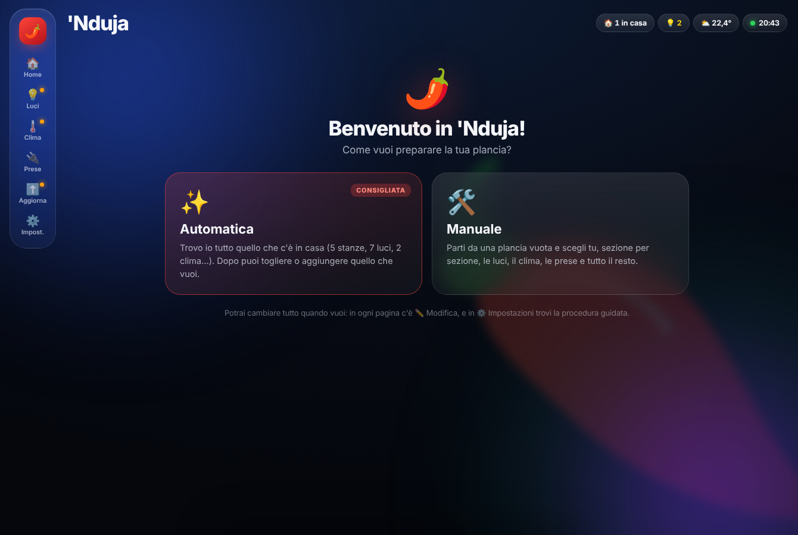

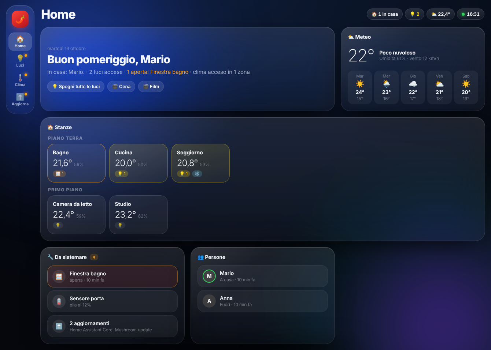

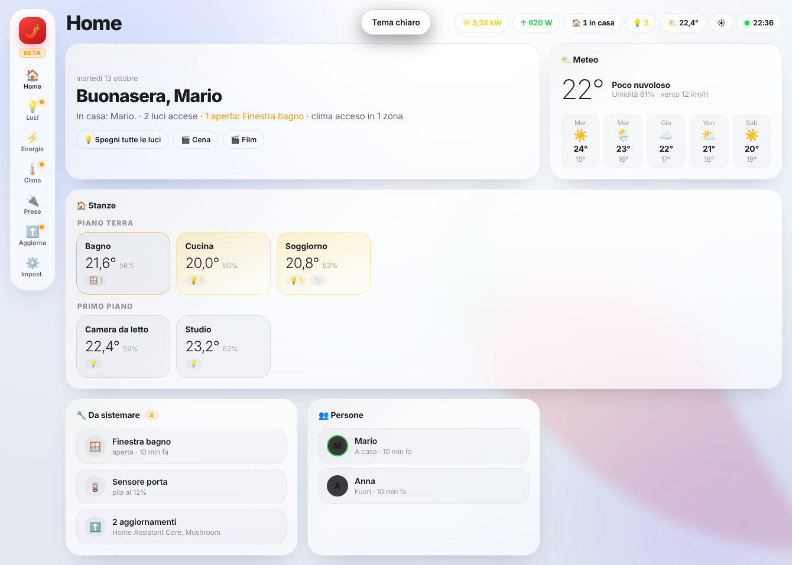

> 🧪 **BETA** — 🇮🇹 la plancia è giovane: funziona, ma può cambiare e avere difetti; segnalali nelle [Issues](https://github.com/gionny781/nduja-dashboard/issues). · 🇬🇧 young project: it works, but may change and have bugs; please report them in [Issues](https://github.com/gionny781/nduja-dashboard/issues).
>
> ⚠️ **Work in progress.** Version 1.0 is being built in stages. Home, People, Calendar, Waste collection, Lights, Climate, Energy and Updates are ready; Map, Vacuum, Cameras and Security are here.

---

## 🇬🇧 English

'Nduja Dashboard adds a full-page dashboard to the Home Assistant sidebar. You don't write any YAML:
it builds itself from your **areas, floors and devices**.

**What you get**
- **Home** – greeting and a one-line summary of the house, weather with 5-day forecast, every room by floor (temperature, humidity, lights on, open windows, climate), people (photo, where they are, distance, phone battery), scenes, waste collection, today's agenda and smart *Alerts* (window open with climate on, rain coming, washing machine done, low batteries, updates). Tap a room to control everything in it.
- **Energy** – an animated scene of your home right now: the sun moves across the sky with the real time, night brings the moon and stars, home weather adds clouds, rain, snow, fog or storms; solar panels light up with production, battery, grid meter and charging car, energy lines with flowing dots, the appliances that are running and a plain-language summary. Plus today's totals, history, costs and device consumption, from Home Assistant's Energy configuration.
- **Calendar** – events from your Home Assistant calendars (today, week, month) and ＋ Event.
- **Chores** – household chores with how often they're due, whose turn it is among your Home Assistant people (taking turns or always the same person) and the last time: «Done» records who and when and passes the turn; overdue ones stand out, «Today's chores» on Home. Shared by everyone: any user can add and mark them.
- **Notice board** – short family messages with author, date and colour: pin one to the top, give it an optional expiry and it disappears by itself. Shared by everyone and it shows up right away on every device; the author or an admin can delete it. The latest ones are on Home.
- **Map** – 2D or 3D, every floor drawn from your areas: lights, windows, climate, motion, temperature; move and resize rooms, put your floor plan underneath.
- **Appliances** – washing machine, dryer, dishwasher, oven…: running/done, power, today's kWh, end time, plug. Each one is **animated** (idle, running, done) with the dashboard's own drawings or with your images/GIFs, also on Home and on the map.
- **Batteries** – every battery in the house found by itself (battery %, «battery low», battery_level), one per device and lowest first, without phones, car and home battery: room, battery type, «no news for days», filters (all / to replace / by room), «You need: 3 × CR2032» for shopping and «I replaced it». With ✏️ add or hide sensors, set thresholds (whole home or per device), type and name; Home and phone alerts follow these choices.
- **Car** – shown only if Home Assistant has a car (Tesla, BMW, VW, Kia/Hyundai, Renault, Polestar, Mercedes…): photo, battery and range, charging, location and controls (lock, climate, charging, trunk, charge limit…).
- **Vacuum** – status, map, room cleaning, quick settings and maintenance. **Cameras** – light previews and, on tap, the live view (WebRTC, HLS, MJPEG or a photo every 2 s, picked by itself and remembered per device) with sound, full screen and snapshot; also in Security. With ✏️: main stream for the live view and sub-stream for the preview (pairs found by themselves), method per stream, add any camera (hidden ones too), remove, rename, reorder and optional groups («Outside», «Inside») shown as separate cards. **Security** – alarm keypad, **access** (gates, garage doors, main doors and locks with big buttons, double tap to open, optional open/closed sensor, also on Home), doors, smoke/gas/water, motion.
- **Lights** – a summary of what's on and where, "turn everything off" and light scenes; then every room by floor with large tiles that glow in the lamp's real colour: tap to switch, drag sideways for brightness, long press for details (white temperature, colour wheel with favourites, effects). Light groups without duplicates, switches that control a light, and with ✏️ order, names and icons.
- **Music** – choose where to listen: **this device** (phone, tablet or PC), any Home Assistant speaker (Alexa, Google/Nest, Sonos…) or a group. Browse Home Assistant's music and radio with cover art and play it right on the dashboard, with a mini player that stays at the bottom while you change page; browse Sonos and Google Cast libraries on the speaker itself; «Ask Alexa» for Echo devices. With **Music Assistant**: search songs, artists, albums, playlists and radio, «radio from here» and the queue. **Move to…** passes the music from one speaker to another; **Favourites** (playlists and stations) for the whole home. Speakers and players by room, with only the controls each one supports.
- **Media** – shown only if you have TVs, set-top boxes, Apple TV, Chromecast, Fire TV, consoles or remotes: each screen with power, source, volume and what's on; a **virtual remote** (D-pad and OK, back, home, menu, volume, channels, number pad) with the right commands for Android/Google TV, Apple TV, Samsung, LG webOS, Sony Bravia, Philips and Fire TV, only the keys that work, and ✏️ to give any key your own command; **streaming apps** as big buttons with text logos and colours drawn for 'Nduja; Harmony activities; a «Media» card on Home for the TV that's on. TVs leave the Music page, which keeps the speakers.
- **Irrigation** – shown only if Home Assistant has something to water with (water valves, irrigation switches, Rain Bird, Hydrawise, Rachio, b-hyve, OpenSprinkler, Gardena…; add more switches, valves or scripts with ✏️): a card per zone with a lawn and sprinkler or a flower bed and drippers drawn for 'Nduja that water while the zone runs and soil that darkens as it gets wet, status and time left, start for 5/10/15/30 minutes or a custom time, stop. The duration uses the integration's own service when there is one; otherwise the «'Nduja · irrigation» script closes the zone after the chosen minutes, even with the dashboard closed. Next scheduled watering, soil moisture, expected rain and «Rain tomorrow: skip watering?», which pauses the schedules (rain delay, Hydrawise suspension, irrigation automations, switches you pick); an «Irrigation» card on Home.
- **Formula 1** – shown by itself with F1 Sensor (HACS), or with a Formula 1 calendar or Team Tracker (racing): the next Grand Prix with the circuit (the integration's image, otherwise a drawing), a countdown and every session time in your home time zone; the live session with flags and Safety Car, lap, running order and race control; drivers' and constructors' standings with your favourite driver and team highlighted; the last race with its podium. A «Formula 1» card on Home and an optional phone alert 15 minutes before qualifying, sprint or race.
- **My team** – shown by itself with Team Tracker or Calcio Live (HACS), or pick a calendar with the matches: next match with a countdown, competition, stadium and TV; the live score with goals and cards and a small goal animation; recent results and the table. Logos come only from the integration, otherwise a badge with your initials and colours. Optional phone alert at every goal and at full time.
- **Boiler** – shown only when it finds one (Ariston, myVAILLANT, ViCare, Bosch/Buderus, Remeha/Baxi/De Dietrich, Immergas, ebusd, OpenTherm Gateway, Plugwise, Netatmo…): the boiler drawn for the dashboard, with the flame growing with the modulation and water flowing to the radiator and the tap; heating on/off, summer/winter/auto and flow set point; hot water temperature, target, comfort/eco and boost; pressure with an alert when out of range, outdoor temperature, error codes in plain words; service from the integration or recorded by hand with a reminder in Alerts; gas use today, this month and history with the cost from the Energy configuration. ✏️ to pick sensors and devices; a compact «Boiler» card on Home. Boiler circuits leave the Climate page, room thermostats stay.
- **Climate** – thermostats and air conditioners by room, plus a temperature/humidity overview of every room. Each one is **animated** (louvres, cold or warm air, drops, fan, flame, radiator heat waves; speed follows the fan) with the dashboard's own drawings, or shown with your images/GIFs or the icon, also on Home and on the map.
- **Automations** – all your automations (switch, run, last run) and a simple builder to create new ones without leaving the dashboard. Automations and scripts created by the dashboard get the **'Nduja** label in Home Assistant.
- **Network** – only if it finds something: Internet status with live download/upload from the modem (FRITZ!Box, UniFi, Omada, Deco, Mikrotik, OpenWrt, Netgear, Asus, Huawei LTE, Vodafone Station, UPnP…), public IP (hidden until tapped), Speedtest with a 7-day chart and «Test now»; cards for modem, mini PC, NAS, Proxmox, Raspberry and printers (on/off, CPU, RAM, disk, temperature, uptime, restart/power on with double confirmation); devices online and new ones seen today; guest Wi-Fi on/off with a QR code drawn by the dashboard; UPS (NUT, APC). ✏️ to add, remove, rename and pick sensors; a compact «Network» card on Home.
- **Updates** – install Home Assistant, add-on, HACS and firmware updates right from the dashboard: release notes, backup before installing, progress bar, *Install all* (Home Assistant last), skip/restore versions.
- **Screensaver** (⚙️ Settings → This device) – drawn for the dashboard: **clock**, **live sky** (sun, moon with its real phase, stars, clouds, rain and snow from your home weather), **home** panels (weather, rooms, people, next events, energy), a very dark **night minimal**, or **your photos** (a Media folder, one image/GIF address or a list) with fade or Ken Burns; **Automatic** uses photos or the sky by day and the night style at night. Live preview, dims at night, wakes on touch.
- Glass design for tablets and phones, **light, dark or automatic theme** (◐ at the top), Italian and English (follows your Home Assistant language).
- **First start**: choose **Automatic** (everything is found for you) or **Manual** (start empty and add what you want).
- **✏️ Edit on every page** (admins): ＋ Add with search, rename, move to another room, ✕ remove. **＋ New page** to create your own pages.
- **New devices** (admins): when something new shows up in Home Assistant, Home tells you «N new devices found»; add it or remove it in one tap. ＋ Add shows **Suggested** devices at the top.
- **Plugs and devices** page: plugs, switches, covers, fans, locks by room.
- **Setup wizard** (⚙️ Settings, admins only): choose rooms and their order, lights, thermostats, the temperature sensor of each room, devices, people, weather, scenes and pages. Choices are saved in Home Assistant and apply to every device.
- **🩺 Check Home Assistant** (⚙️ Settings, admins only): a plain-language check of rooms, floors, Energy, weather, people, devices that don't respond and the Home Assistant version, with a button to the right Home Assistant screen for each ⚠️. It only reads, it never changes anything.
- If the dashboard can't connect or start, it shows **what to check**, «Try again» and the details for support instead of a blank page.
- Pages show up only when you have the matching devices.

### Installation
1. HACS → ⋮ → **Custom repositories** → add `https://github.com/gionny781/nduja-dashboard`, category **Integration**.
2. Search **'Nduja Dashboard** in HACS → **Download**.
3. Restart Home Assistant.
4. **Settings → Devices & services → Add integration → 'Nduja Dashboard**.
5. Open **🌶️ 'Nduja** in the sidebar.

**Options** (Settings → Devices & services → 'Nduja Dashboard → Configure): sidebar name and icon, admin-only access, and the energy sensors (optional – left empty, the dashboard looks for them by itself).

### Tips
- Assign every device to an **area**, and areas to **floors**: that's what the dashboard uses to draw your house.
- Hidden entities and configuration/diagnostic entities are ignored.

---

## 🇮🇹 Italiano

'Nduja Dashboard aggiunge alla barra laterale di Home Assistant una plancia a pagina intera. Niente YAML:
si costruisce da sola dalle tue **aree, piani e dispositivi**.

**Cosa trovi**
- **Home** – saluto e riepilogo della casa in una riga, meteo con le previsioni a 5 giorni, tutte le stanze divise per piano (temperatura, umidità, luci accese, finestre aperte, clima), persone (foto, dove sono, distanza, batteria del telefono), scene, raccolta differenziata, agenda di oggi e *Avvisi* intelligenti (finestra aperta col clima acceso, pioggia in arrivo, lavatrice finita, pile scariche, aggiornamenti). Tocca una stanza per comandare tutto quello che c'è dentro.
- **Energia** – una scena animata della casa in questo momento: il sole attraversa il cielo con l'ora vera, di notte arrivano luna e stelle, il meteo di casa aggiunge nuvole, pioggia, neve, nebbia o temporale; i pannelli si illuminano con la produzione, poi batteria, contatore della rete e auto in carica, linee di energia con i pallini che scorrono, gli elettrodomestici accesi e un riepilogo in parole semplici. Più totali di oggi, storico, costi e consumi dei dispositivi, dalla configurazione Energia di Home Assistant.
- **Calendario** – gli eventi dei calendari di Home Assistant (oggi, settimana, mese) e ＋ Evento.
- **Faccende** – i lavori di casa con ogni quanto vanno fatti, a chi tocca tra le persone di Home Assistant (a turno o sempre la stessa) e l'ultima volta: «Fatto» registra chi e quando e passa il turno; quelli in ritardo si vedono subito, in Home «Faccende di oggi». Condivise da tutti: qualsiasi utente può aggiungerle e segnarle.
- **Bacheca** – messaggi brevi per la famiglia con autore, data e colore: uno si può appuntare in alto e con la scadenza facoltativa sparisce da solo. Condivisa da tutti e subito visibile su ogni dispositivo; la cancella chi l'ha scritto oppure un amministratore. Gli ultimi messaggi sono anche in Home.
- **Mappa** – in 2D o 3D, ogni piano disegnato dalle aree: luci, finestre, clima, movimento, temperatura; sposta e ridimensiona le stanze, metti sotto la tua piantina.
- **Elettrodomestici** – lavatrice, asciugatrice, lavastoviglie, forno…: in funzione/finito, potenza, kWh di oggi, ora di fine, presa. Ognuno è **animato** (fermo, in funzione, finito) con i disegni della plancia o con le tue immagini/GIF, anche nella Home e nella mappa.
- **Batterie** – tutte le pile di casa trovate da sole (% di batteria, «batteria bassa», battery_level), una per dispositivo e dalla più scarica, senza telefoni, auto e batteria di casa: stanza, tipo di pila, «nessuna notizia da giorni», filtri (tutte / da cambiare / per stanza), «Ti servono: 3 × CR2032» per la spesa e «Ho cambiato la pila». Con ✏️ aggiungi o nascondi sensori, scegli le soglie (per tutta la casa o per dispositivo), tipo e nome; gli avvisi della Home e sul telefono seguono queste scelte.
- **Auto** – compare solo se in Home Assistant c'è un'auto (Tesla, BMW, VW, Kia/Hyundai, Renault, Polestar, Mercedes…): foto, batteria e autonomia, ricarica, posizione e comandi (apri/chiudi, clima, ricarica, baule, limite di ricarica…).
- **Robot** – stato, mappa, pulizia per stanza, impostazioni rapide e manutenzione. **Telecamere** – anteprime leggere e, al tocco, la diretta (WebRTC, HLS, MJPEG o una foto ogni 2 s, scelto da solo e ricordato per dispositivo) con audio, tutto schermo e istantanea; anche in Sicurezza. Con ✏️: flusso principale per la diretta e sub-stream per l'anteprima (le coppie le trova da sola), metodo per ogni flusso, aggiungi qualsiasi telecamera (anche nascosta), togli, rinomina, riordina e gruppi facoltativi («Esterno», «Interno») in schede separate. **Sicurezza** – allarme col tastierino, **accessi** (cancelli, garage, portoni e serrature con pulsanti grandi, doppio tocco per aprire, sensore aperto/chiuso facoltativo, anche in Home), porte, fumo/gas/acqua, movimento.
- **Luci** – riepilogo di cosa è acceso e dove, «spegni tutto» e scene di luce; poi tutte le stanze per piano con tessere grandi che si illuminano del colore vero della lampada: tocco per accendere, trascina in orizzontale per la luminosità, pressione lunga per i dettagli (temperatura del bianco, ruota dei colori con i preferiti, effetti). Gruppi di luci senza doppioni, interruttori che comandano una luce e, con ✏️, ordine, nomi e icone.
- **Musica** – scegli dove ascoltare: **questo dispositivo** (telefono, tablet o PC), una qualsiasi cassa di Home Assistant (Alexa, Google/Nest, Sonos…) o un gruppo. Sfoglia la musica e le radio di Home Assistant con le copertine e ascoltale direttamente sulla plancia, con il mini lettore che resta in basso mentre cambi pagina; sfoglia le librerie di Sonos e Google Cast sulla cassa stessa; «Chiedi ad Alexa» per gli Echo. Con **Music Assistant**: cerca brani, artisti, album, playlist e radio, «radio da qui» e la coda. **Sposta su…** passa la musica da una cassa all'altra; **Preferiti** (playlist e radio) per tutta la casa. Casse e lettori per stanza, con i soli comandi che ognuno supporta.
- **Media** – compare solo se hai TV, decoder, Apple TV, Chromecast, Fire TV, console o telecomandi: ogni schermo con accensione, sorgente, volume e quello che è in onda; un **telecomando virtuale** (croce e OK, indietro, home, menu, volume, canali, tastierino numerico) con i comandi giusti per Android/Google TV, Apple TV, Samsung, LG webOS, Sony Bravia, Philips e Fire TV, solo i tasti che funzionano, e ✏️ per dare a un tasto un comando tuo; le **app di streaming** come pulsanti grandi con loghi di testo e colori disegnati per 'Nduja; le attività di Harmony; la scheda «Media» in Home per la TV accesa. Le TV escono dalla pagina Musica, che tiene le casse.
- **Irrigazione** – compare solo se in Home Assistant c'è qualcosa per irrigare (valvole dell'acqua, switch da irrigazione, Rain Bird, Hydrawise, Rachio, b-hyve, OpenSprinkler, Gardena…; altri switch, valvole o script si aggiungono con ✏️): una tessera per zona con il prato e l'irrigatore o l'aiuola e i gocciolatori disegnati per 'Nduja, che bagnano mentre la zona è accesa, e il terreno che si scurisce; stato e tempo che manca, avvio per 5/10/15/30 minuti o una durata tua, stop. La durata usa il servizio dell'integrazione se c'è; altrimenti lo script «'Nduja · irrigazione» chiude la zona dopo i minuti scelti, anche a plancia chiusa. Prossima irrigazione, umidità del terreno, pioggia prevista e «Domani piove: vuoi saltare l'irrigazione?», che mette in pausa i programmi (ritardo pioggia, sospensione di Hydrawise, automazioni dell'irrigazione, switch scelti da te); la scheda «Irrigazione» in Home.
- **Formula 1** – compare da sola con F1 Sensor (HACS), oppure con un calendario della Formula 1 o con Team Tracker (racing): il prossimo Gran Premio con il circuito (l'immagine dell'integrazione, altrimenti un disegno), il conto alla rovescia e gli orari di tutte le sessioni nell'ora di casa; la sessione in corso con bandiere e safety car, giro, ordine in pista e direzione gara; le classifiche piloti e costruttori con il pilota e il team preferiti evidenziati; l'ultima gara con il podio. La scheda «Formula 1» in Home e un avviso facoltativo sul telefono 15 minuti prima di qualifiche, sprint o gara.
- **La mia squadra** – compare da sola con Team Tracker o Calcio Live (HACS), oppure scegli un calendario con le partite: prossima partita con il conto alla rovescia, competizione, stadio e TV; la diretta con gol e cartellini e una piccola animazione al gol; ultimi risultati e classifica. I loghi vengono solo dall'integrazione, altrimenti uno stemma con sigla e colori tuoi. Avviso facoltativo sul telefono a ogni gol e a fine partita.
- **Caldaia** – compare solo se la trova (Ariston, myVAILLANT, ViCare, Bosch/Buderus, Remeha/Baxi/De Dietrich, Immergas, ebusd, OpenTherm Gateway, Plugwise, Netatmo…): la caldaia disegnata dalla plancia, con la fiamma che cresce con la modulazione e l'acqua che scorre verso il termosifone e il rubinetto; riscaldamento acceso/spento, estate/inverno/auto e mandata impostata; acqua calda con temperatura, setpoint, comfort/eco e boost; pressione con avviso se fuori range, temperatura esterna, codici d'errore in chiaro; manutenzione dall'integrazione o annotata a mano con promemoria negli Avvisi; consumi del gas di oggi, del mese e storico con il costo della configurazione Energia. ✏️ per scegliere sensori e dispositivi; in Home la scheda compatta «Caldaia». I circuiti della caldaia escono dalla pagina Clima, i termostati delle stanze restano.
- **Clima** – termostati e condizionatori per stanza, più la temperatura e l'umidità di ogni stanza. Ognuno è **animato** (alette, aria fredda o calda, gocce, ventola, fiamma, onde di calore del radiatore; la velocità segue la ventola) con i disegni della plancia, oppure con le tue immagini/GIF o l'icona, anche nella Home e nella mappa.
- **Automazioni** – tutte le tue automazioni (interruttore, esegui, ultima volta) e un costruttore semplice per crearne di nuove senza uscire dalla plancia. Le automazioni e gli script creati dalla plancia hanno l'etichetta **'Nduja** in Home Assistant.
- **Rete** – solo se trova qualcosa: stato di internet con download e upload in tempo reale dal modem (FRITZ!Box, UniFi, Omada, Deco, Mikrotik, OpenWrt, Netgear, Asus, Huawei LTE, Vodafone Station, UPnP…), IP pubblico (nascosto finché non lo tocchi), Speedtest con il grafico di 7 giorni e «Prova adesso»; schede per modem, mini PC, NAS, Proxmox, Raspberry e stampanti (acceso/spento, CPU, RAM, disco, temperatura, uptime, riavvio/accensione con doppia conferma); dispositivi online e nuovi visti oggi; Wi-Fi ospiti on/off con il QR disegnato dalla plancia; gruppo di continuità (NUT, APC). ✏️ per aggiungere, togliere, rinominare e scegliere i sensori; in Home la scheda compatta «Rete».
- **Aggiornamenti** – installa dalla plancia gli aggiornamenti di Home Assistant, dei componenti aggiuntivi, di HACS e dei firmware: novità, backup prima di installare, avanzamento, *Installa tutti* (Home Assistant per ultimo), versioni saltate.
- **Salvaschermo** (⚙️ Impostazioni → Questo dispositivo) – disegnato per la plancia: **orologio**, **cielo vivo** (sole, luna con la sua fase vera, stelle, nuvole, pioggia e neve dal meteo di casa), pannelli della **casa** (meteo, stanze, persone, prossimi impegni, consumi), un **minimal notturno** scurissimo oppure **le tue foto** (una cartella dei Media, un indirizzo di immagine/GIF o un elenco) in dissolvenza o con l'effetto Ken Burns; **Automatico** usa foto o cielo di giorno e il minimal di notte. Anteprima dal vivo, attenuazione notturna, si sveglia al tocco.
- Grafica in vetro per tablet e telefono, **tema chiaro, scuro o automatico** (◐ in alto), in italiano e in inglese (segue la lingua di Home Assistant).
- **Primo avvio**: scegli **Automatica** (trovo tutto io) o **Manuale** (parti da zero e aggiungi quello che vuoi).
- **✏️ Modifica in ogni pagina** (amministratori): ＋ Aggiungi con ricerca, cambia nome, sposta in un'altra stanza, ✕ togli. **＋ Nuova pagina** per creare pagine tue.
- **Dispositivi nuovi** (amministratori): quando in Home Assistant compare qualcosa di nuovo, la Home ti dice «N dispositivi nuovi trovati»; lo aggiungi o lo togli con un tocco. In ＋ Aggiungi trovi in cima i **Suggeriti**.
- Pagina **Prese e dispositivi**: prese, interruttori, tapparelle, ventilatori, serrature per stanza.
- **Wizard di configurazione** (⚙️ Impostazioni, solo amministratori): scegli stanze e ordine, luci, termostati, il sensore di temperatura di ogni stanza, dispositivi, persone, meteo, scene e pagine. Le scelte si salvano in Home Assistant e valgono su tutti i dispositivi.
- **🩺 Controlla Home Assistant** (⚙️ Impostazioni, solo amministratori): un controllo in parole semplici di stanze, piani, Energia, meteo, persone, dispositivi che non rispondono e versione di Home Assistant, con un pulsante che per ogni ⚠️ apre la schermata giusta di Home Assistant. Legge soltanto, non cambia niente.
- Se la plancia non si collega o non parte, al posto della pagina bianca mostra **cosa controllare**, «Riprova» e i dettagli per l'assistenza.
- Le pagine compaiono solo se hai i dispositivi giusti.

### Installazione
1. HACS → ⋮ → **Archivi digitali personalizzati** → aggiungi `https://github.com/gionny781/nduja-dashboard`, categoria **Integrazione**.
2. Cerca **'Nduja Dashboard** in HACS → **Scarica**.
3. Riavvia Home Assistant.
4. **Impostazioni → Dispositivi e servizi → Aggiungi integrazione → 'Nduja Dashboard**.
5. Apri **🌶️ 'Nduja** nella barra laterale.

**Opzioni** (Impostazioni → Dispositivi e servizi → 'Nduja Dashboard → Configura): nome e icona nella barra laterale, accesso solo per amministratori, sensori dell'energia (facoltativi: se li lasci vuoti la plancia li cerca da sola).

### Consigli
- Assegna ogni dispositivo a un'**area** e le aree ai **piani**: è da lì che la plancia disegna la casa.
- Le entità nascoste e quelle di configurazione o diagnostica vengono ignorate.

---

| Lights / Luci | Climate / Clima |
|---|---|
| 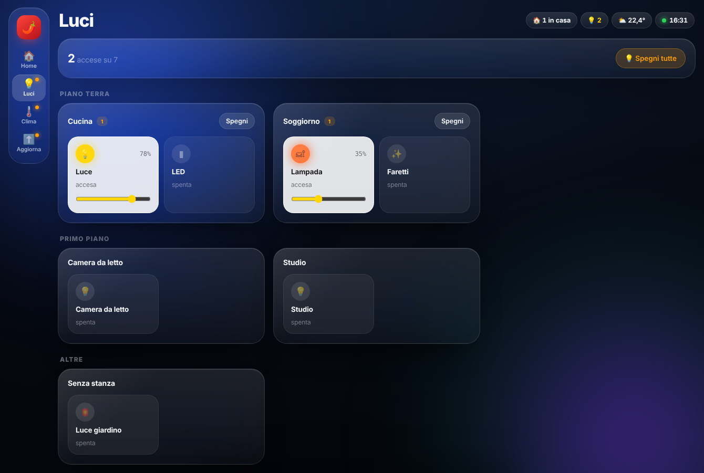 | 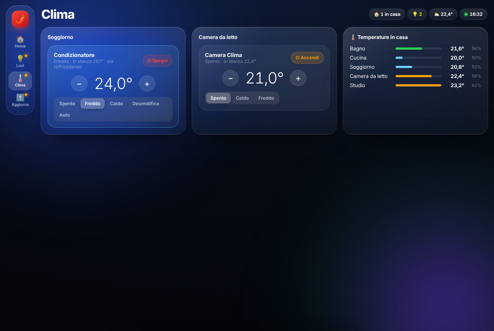 |
| **Room / Stanza** | **Updates / Aggiornamenti** |
| 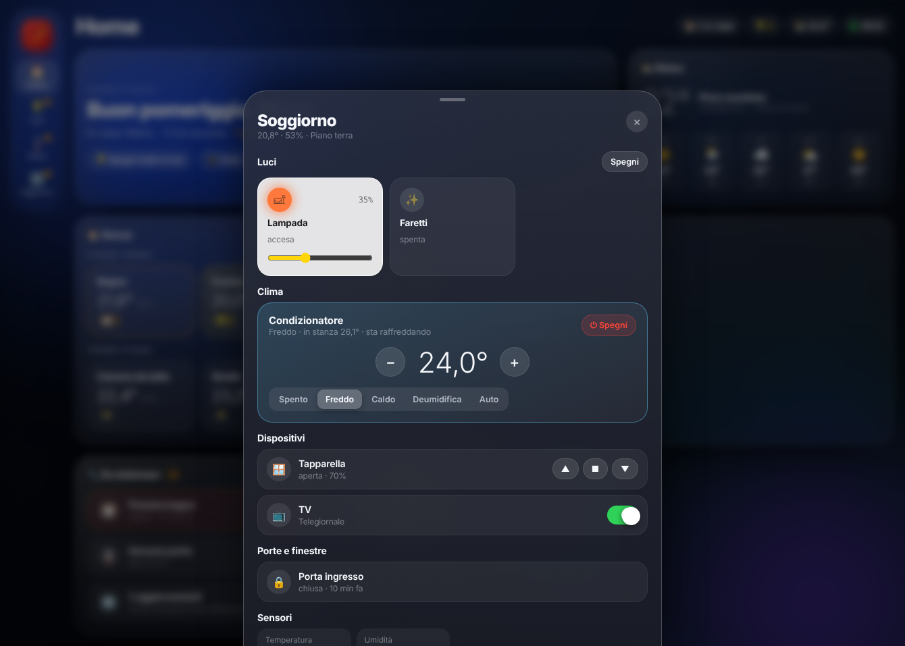 | 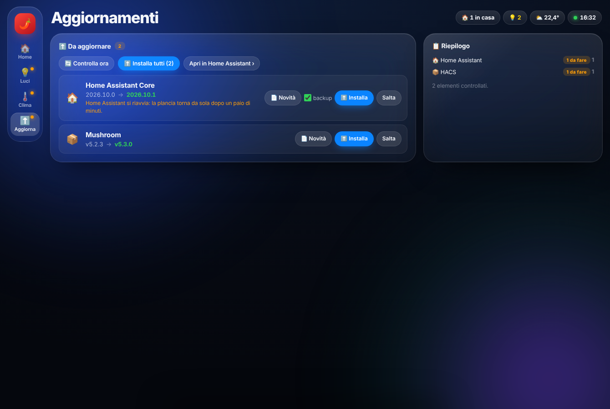 |
| **Energy / Energia** | **Wizard** |
| 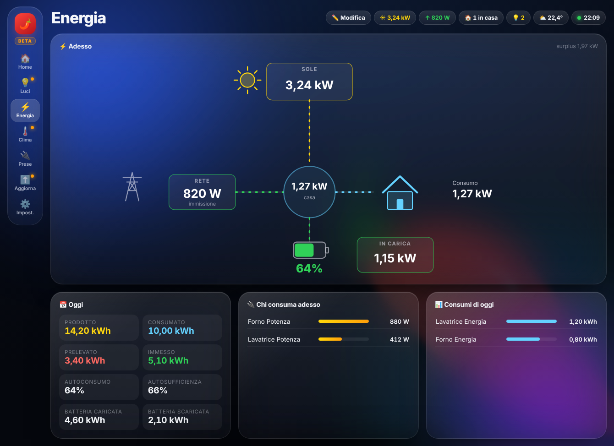 | 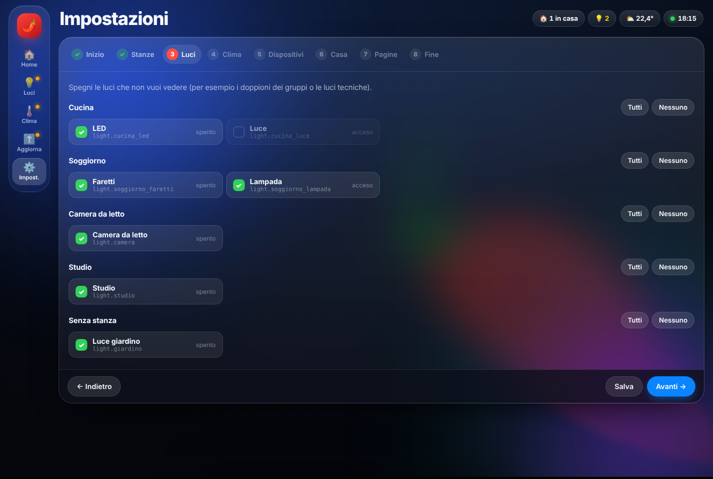 |
| **Edit / Modifica** | **Security / Sicurezza** |
| 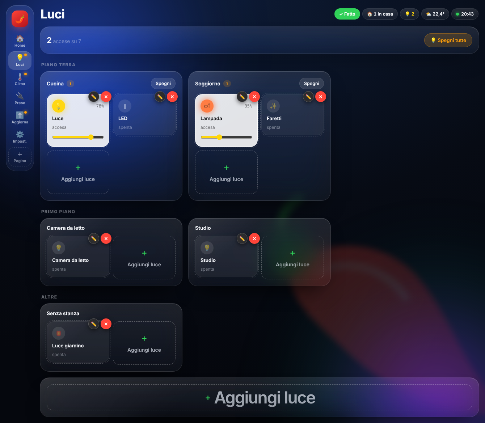 | 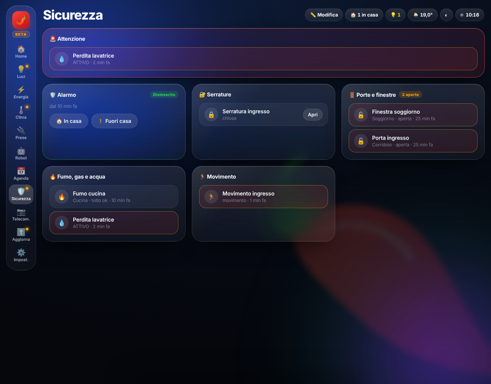 |
| **Map / Mappa** | **Appliances / Elettrodomestici** |
| 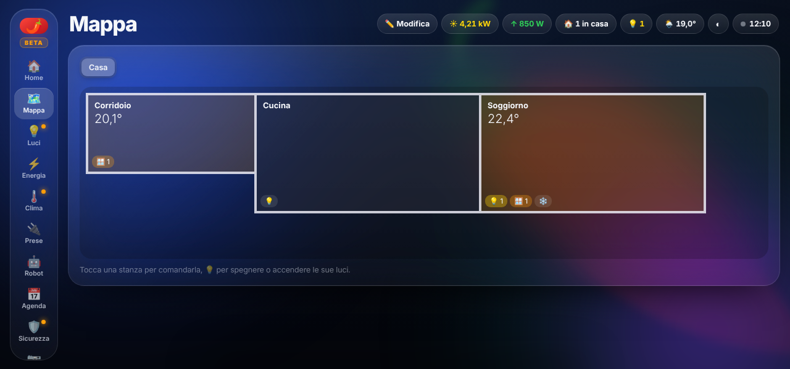 | 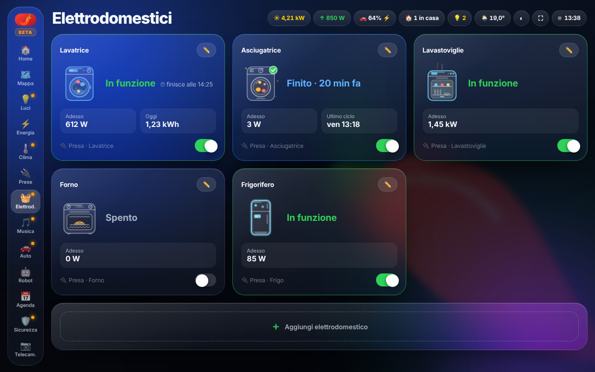 |
| **3D** | |
| 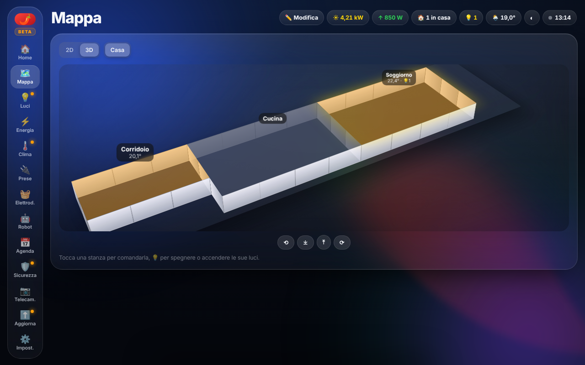 | |

## ☕ Supporta il progetto / Support the project

🇮🇹 Se 'Nduja Dashboard ti piace e vuoi aiutarmi a portarla avanti, puoi offrirmi un caffè: **[paypal.me/gionny781](https://www.paypal.me/gionny781)**. Grazie! 🌶️

🇬🇧 If you enjoy 'Nduja Dashboard and want to help it grow, you can buy me a coffee: **[paypal.me/gionny781](https://www.paypal.me/gionny781)**. Thank you! 🌶️

## Licenza / License
MIT © gionny781

'Nduja Dashboard è sotto licenza **MIT** (`LICENSE`). Include [hls.js](https://github.com/video-dev/hls.js) (Apache License 2.0): vedi [THIRD_PARTY_LICENSES.md](THIRD_PARTY_LICENSES.md).
'Nduja Dashboard is **MIT** licensed (`LICENSE`). It bundles [hls.js](https://github.com/video-dev/hls.js) (Apache License 2.0): see [THIRD_PARTY_LICENSES.md](THIRD_PARTY_LICENSES.md).
